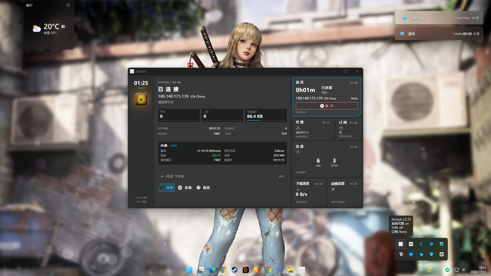

<h1 align="center">
  
  <br>
  ArClash
  <br>
</h1>

<h3 align="center">
  明日方舟风格的 Mihomo 桌面客户端 · 基于 Tauri 2 + React
</h3>

<p align="center">
  Forked from <a href="https://github.com/clash-verge-rev/clash-verge-rev">clash-verge-rev</a> v2.5.10 · License: GPL-3.0
</p>

---

## 预览



## 这是什么

ArClash 是 [clash-verge-rev](https://github.com/clash-verge-rev/clash-verge-rev) 的二次开发版：保留其 Mihomo 内核管理与系统能力，界面按明日方舟 UI 风格重做，并带一套自己的服务身份。

> This is a personal fork of clash-verge-rev v2.5.10 with an Arknights-styled UI. The upstream base is imported as a single parentless snapshot commit (`Release: v2.5.10`); upstream history lives [here](https://github.com/clash-verge-rev/clash-verge-rev).

## 相对上游的主要改动

- **界面重做**：首页状态块（RS-00～RS-05 卡片布局）、下载速度页、方舟风格主题与配色 token、蒸汽朋克开关
- **RS-00 显示逻辑**：节点名位置显示当前模式英文（`Rule / Global / Direct / Disconnect`），IP 行连接时经内核代理口探测**节点出口 IP**（不走订阅 server 域名），断开/直连显示本地出口
- **全局模式联动**：切到全局时自动把规则模式选中的节点写入 GLOBAL 组，节点行不再冒出 `DIRECT`
- **系统代理归属判定**：`enable_system_proxy=false` 时只清理本应用自己设置的 OS 代理（按 host:port / PAC URL 匹配），不碰其他软件（如 FlClash）设置的代理
- **独立服务身份**：自带 `arclash-service`（vendored `clash_verge_service_ipc`），与 Verge 的服务彻底分离
- **预览工具**：`web:preview` 提供 mock 全界面态（连接/断开/规则/全局/直连/未选节点/空订阅），UI 改动不用编译即可验证

## 构建

```bash
pnpm install

# 前端类型检查 + 生产构建（产物在 dist/）
pnpm web:build

# 桌面应用（release 产物在 target/release/）
cd src-tauri && cargo build --release
```

预览（不编译内核）：

```bash
pnpm web:preview   # http://127.0.0.1:8802/，?state=direct|unselected|disconnected|empty|empty-global 切换界面态
```

## 目录说明

| 路径 | 内容 |
| --- | --- |
| `src/` | React 前端（`components/home`、`assets/styles/arclash-theme.scss` 等） |
| `src-tauri/` | Tauri 2 后端（`core/sysopt.rs` 系统代理归属、`core/` 内核管理） |
| `src-tauri/vendor/` | vendored 第三方（`clash-verge-service-ipc`，GPL-3.0） |

## 许可

本项目沿用 **GPL-3.0-only**。基于 clash-verge-rev（及其依赖的 Mihomo 生态）的代码，其原始版权与许可声明均予保留，详见 [LICENSE](./LICENSE) 与 [THIRD-PARTY-NOTICES.md](./THIRD-PARTY-NOTICES.md)。

隐私相关说明见 [PRIVACY.md](./PRIVACY.md)。
