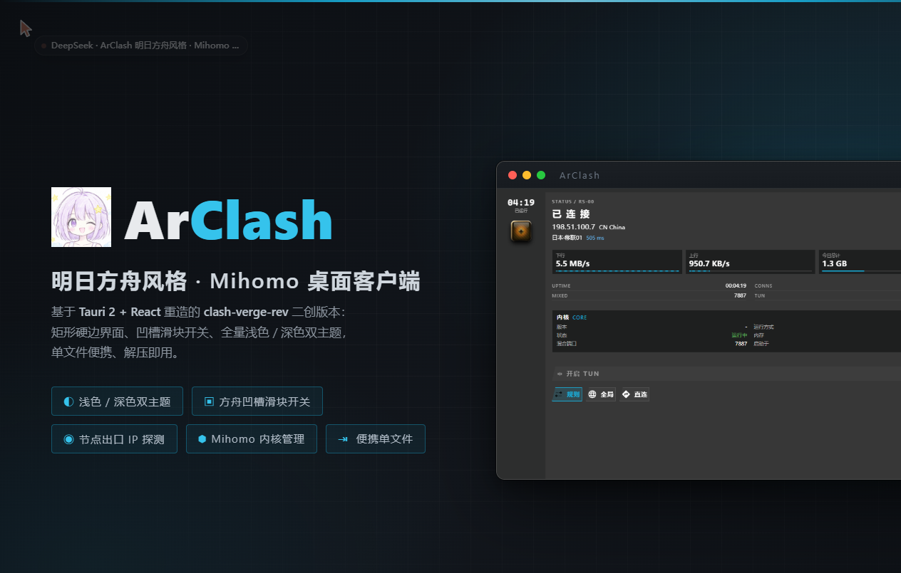
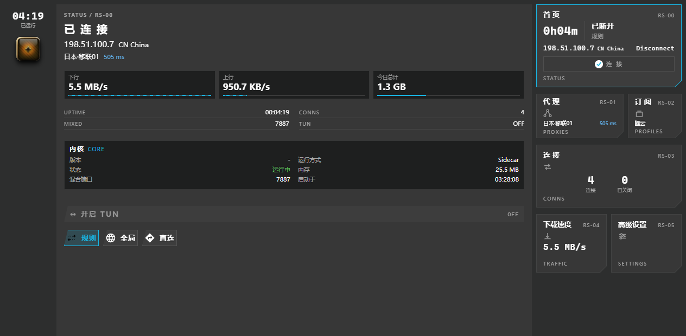
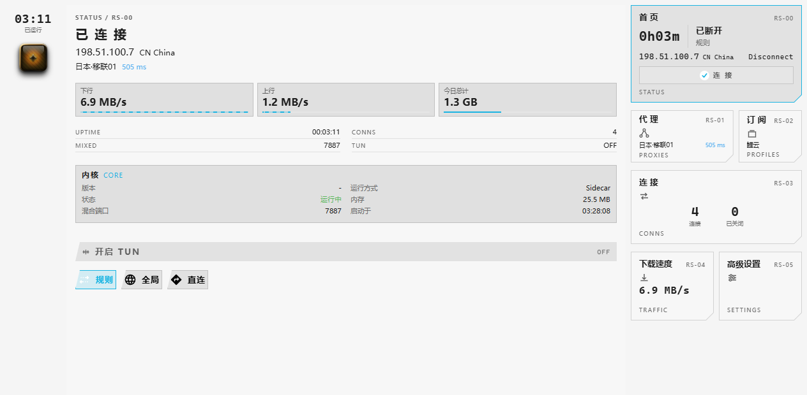
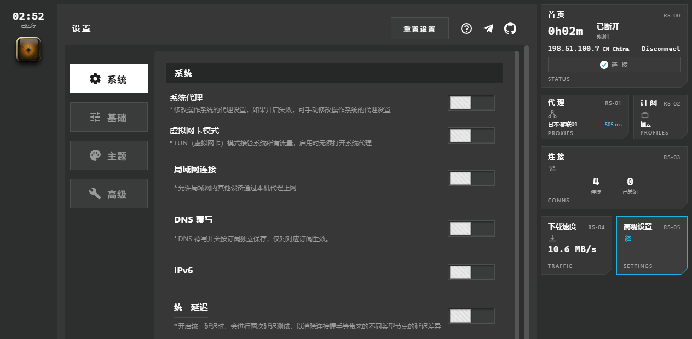

<h1 align="center">
  
</h1>

<div align="center">
  
</div>

<div align="center">

   

**[⬇ 前往 Releases 下载](https://github.com/lhuogogo/arclash/releases/latest)**

</div>

---

## 这是什么

ArClash 是 [clash-verge-rev](https://github.com/clash-verge-rev/clash-verge-rev) 的二次开发版：保留其 Mihomo 内核管理与系统能力，界面按明日方舟 UI 风格重做，并带一套自己的服务身份。

上游官网：[clash-verge-rev.github.io](https://clash-verge-rev.github.io/) · 上游仓库：[clash-verge-rev/clash-verge-rev](https://github.com/clash-verge-rev/clash-verge-rev)

> This is a personal fork of clash-verge-rev v2.5.10 with an Arknights-styled UI. The upstream base is imported as a single parentless snapshot commit (`Release: v2.5.10`); upstream history lives [here](https://github.com/clash-verge-rev/clash-verge-rev).

## ✨ 功能特性

**界面**
- 明日方舟风格：矩形硬边、1px 描边、无圆角无渐变的克制视觉语言
- 全量浅色 / 深色双主题，支持「跟随系统」三态切换，深色基调零妥协
- 首页 RS-00～RS-05 卡片式导航：运行状态、代理、订阅、连接、下载速度、设置一屏直达
- 连接状态一目了然：已连接 / 已断开、当前模式、节点与延迟、上下行速率同屏展示

**连接与内核**
- Mihomo 内核管理：内核版本 / 运行方式 / 内存 / 混合端口 / 启动时间实时展示
- 节点出口 IP 探测：连接时经内核代理口探测**节点出口 IP** 与国家地区（不走订阅 server 域名，避免 CDN 误判）；断开或直连时显示本地出口
- 延迟五档配色：金 / 紫 / 蓝 / 绿 / 红 全项目统一，一眼读出节点质量
- 全局模式联动：切到全局自动把规则模式选中的节点写入 GLOBAL 组

**系统与安全**
- 系统代理归属判定：只清理本应用自己设置的 OS 代理（按 host:port / PAC URL 匹配），不碰其他软件（如 FlClash）设置的代理
- 启动默认断开：不自动启用系统代理和 TUN，点「连接」才恢复上次状态
- 独立服务身份 `arclash-service`（vendored `clash_verge_service_ipc`），与 Verge 的服务彻底分离
- 便携单文件：前端资源内嵌进 exe，解压即用、卸载即走

## 📸 界面预览

| 深色 · 首页 | 浅色 · 首页 |
| --- | --- |
|  |  |

| 设置 · 系统区 |
| --- |
|  |

## 📥 下载使用

1. 前往 [**Releases**](https://github.com/lhuogogo/arclash/releases/latest) 下载 `ArClash-vX.X.X-x64.zip`
2. 解压得到 `ArClash.exe`，双击运行——无需安装
3. 首次使用需自备订阅：在「订阅」页导入你的配置链接
4. 点首页「连接」按钮启用代理，或按需开启 TUN 模式

**系统要求**：Windows 10/11 x64（WebView2 运行时随系统自带，缺省时应用会引导安装）。

> 从源码构建请看下方[构建](#构建)一节；更新包同样在 Releases 页发布，整包替换即可升级。

## 相对上游的主要改动

- **界面重做**：首页状态块（RS-00～RS-05 卡片布局）、下载速度页、方舟风格主题与配色 token、凹槽滑块开关
- **全量浅色模式**：全套 `--ark-*` 变量浅色分支，深浅色随主题切换整体联动
- **设置页交互统一**：日志等级 / 打开目录改为下拉选择器，弹出菜单统一从中心展开；分区按钮选中态反色显示
- **RS-00 显示逻辑**：节点名位置显示当前模式英文（`Rule / Global / Direct / Disconnect`），IP 行连接时经内核代理口探测**节点出口 IP**（不走订阅 server 域名），断开/直连显示本地出口
- **连接按钮图标分态**：未连接显示打勾（去连接）、已连接显示叉（去断开）
- **全局模式联动**：切到全局时自动把规则模式选中的节点写入 GLOBAL 组，节点行不再冒出 `DIRECT`
- **系统代理归属判定**：`enable_system_proxy=false` 时只清理本应用自己设置的 OS 代理（按 host:port / PAC URL 匹配），不碰其他软件（如 FlClash）设置的代理
- **独立服务身份**：自带 `arclash-service`（vendored `clash_verge_service_ipc`），与 Verge 的服务彻底分离
- **预览工具**：`web:preview` 提供 mock 全界面态（连接/断开/规则/全局/直连/未选节点/空订阅），UI 改动不用编译即可验证

## 构建

```bash
pnpm install

# 前端类型检查 + 生产构建（产物在 dist/）
pnpm web:build

# 桌面应用（release 产物在 target/release/）
cd src-tauri && cargo build --release
```

预览（不编译内核）：

```bash
pnpm web:preview   # http://127.0.0.1:8802/，?state=direct|unselected|disconnected|empty|empty-global 切换界面态
```

## 目录说明

| 路径 | 内容 |
| --- | --- |
| `src/` | React 前端（`components/home`、`assets/styles/arclash-theme.scss` 等） |
| `src-tauri/` | Tauri 2 后端（`core/sysopt.rs` 系统代理归属、`core/` 内核管理） |
| `src-tauri/vendor/` | vendored 第三方（`clash-verge-service-ipc`，GPL-3.0） |

## 许可

本项目沿用 **GPL-3.0-only**。基于 clash-verge-rev（及其依赖的 Mihomo 生态）的代码，其原始版权与许可声明均予保留，详见 [LICENSE](./LICENSE) 与 [THIRD-PARTY-NOTICES.md](./THIRD-PARTY-NOTICES.md)。

隐私相关说明见 [PRIVACY.md](./PRIVACY.md)。
